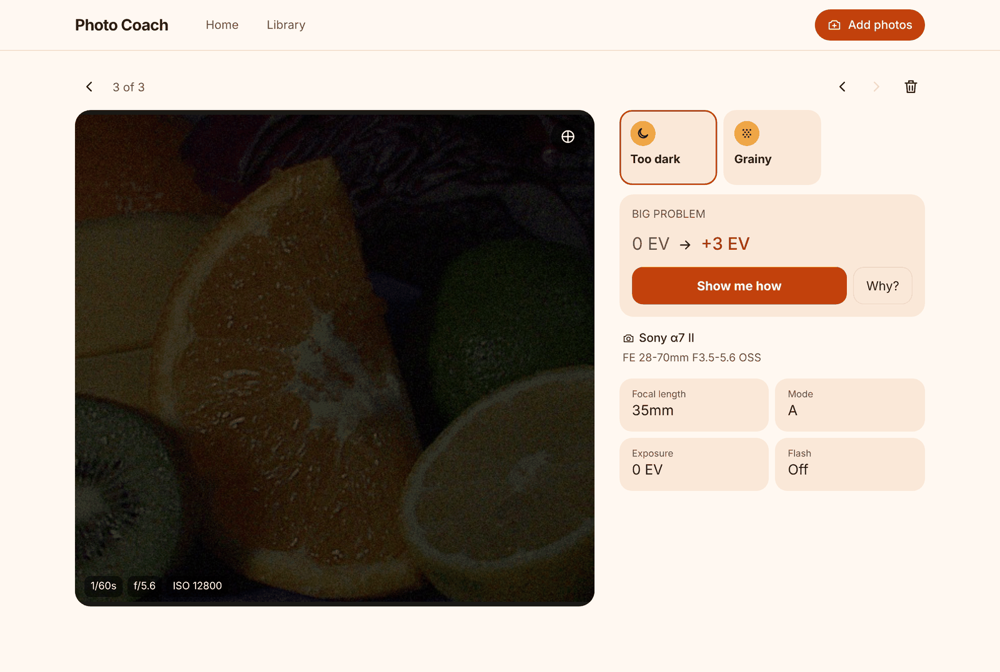
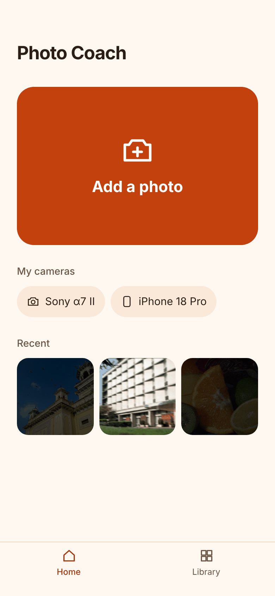
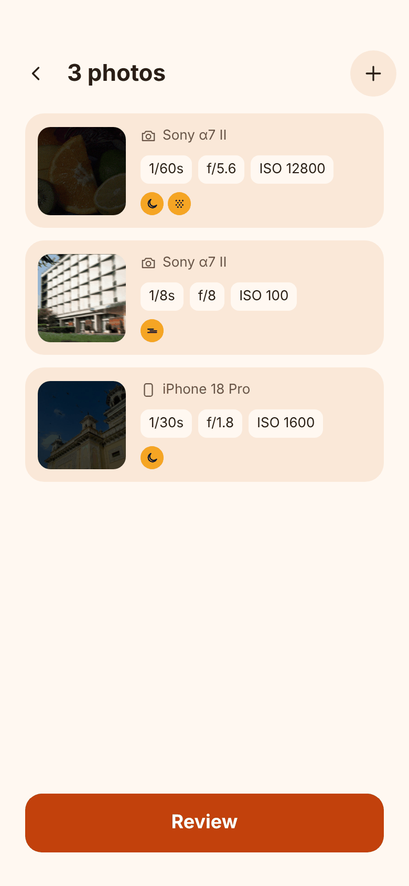
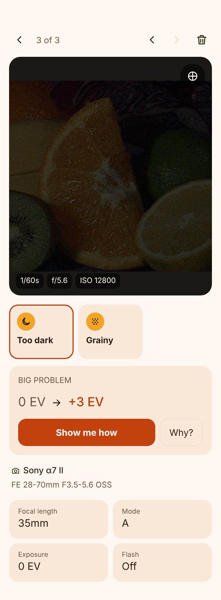
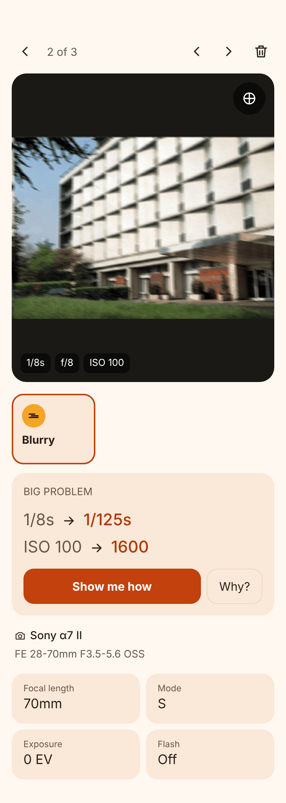
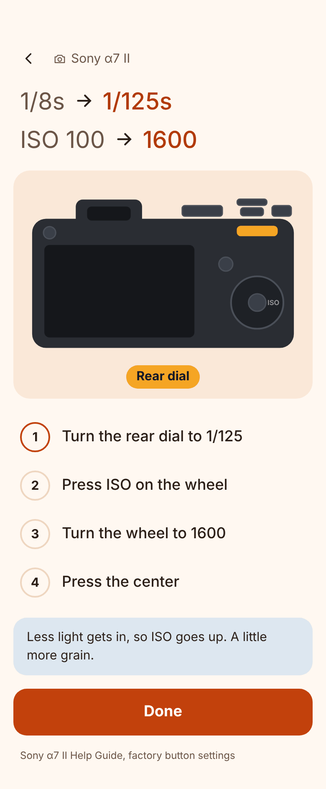
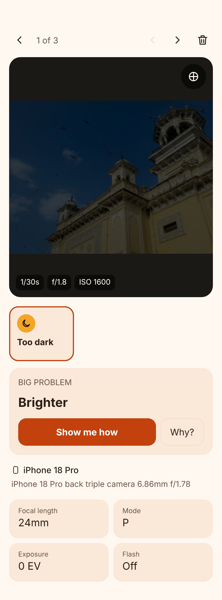
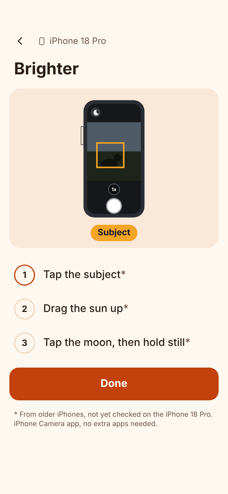
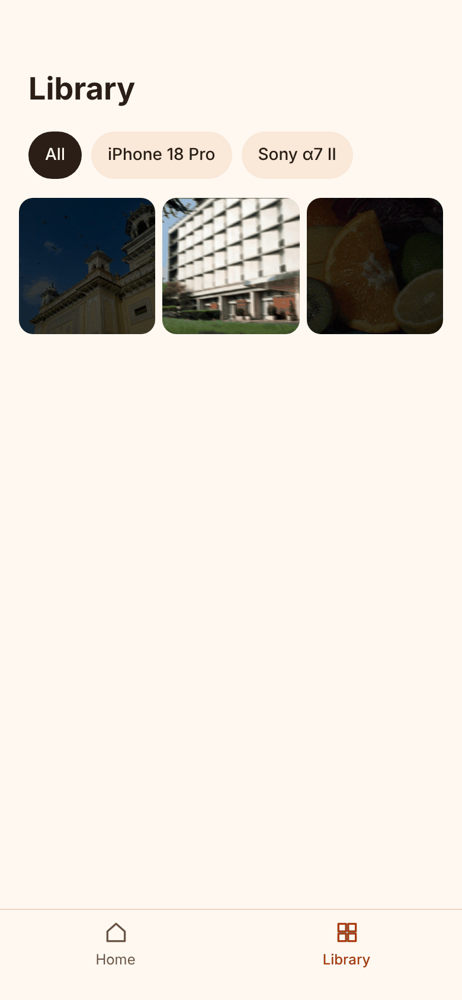

# Photo Coach

**Learn your camera by looking at your own photos.**

Photo Coach is for people who just got a camera (or want more from their phone) and keep shooting in Auto because the settings feel confusing. You add a photo you took, and Photo Coach shows you what went wrong, which setting to change, and exactly which buttons to press on your camera.

No jargon tests, no theory first. You learn from the photo you just took.

## How to use it

<p align="center">
  
</p>

1. **Take some photos** with your camera or phone. Bad ones are best: too dark, blurry, noisy.
2. **Add them.** Tap **Add a photo**, or on a computer drag them onto the page.
3. **See what went wrong.** Each photo gets problem tiles like "Too dark" or "Blurry". Tap **Why?** for the reason, and ⊕ to see where the problem is.
4. **See the fix.** Each problem shows the setting to change, like `1/8s → 1/125s`.
5. **Tap Show me how** for the buttons to press on *your* camera, one step at a time.

<table>
  <tr>
    <td align="center" width="25%"><br><b>Add a photo</b></td>
    <td align="center" width="25%"><br><b>Settings read for you</b></td>
    <td align="center" width="25%"><br><b>What went wrong</b></td>
    <td align="center" width="25%"><br><b>What to change</b></td>
  </tr>
  <tr>
    <td align="center"><br><b>Sony α7 II: which buttons</b></td>
    <td align="center"><br><b>iPhone works too</b></td>
    <td align="center"><br><b>iPhone: which taps</b></td>
    <td align="center"><br><b>Your photos, saved</b></td>
  </tr>
</table>

<sub>Screenshots use sample photos darkened or blurred on purpose, with made-up camera settings.</sub>

> Use the original file. Sending a photo through Messages, WhatsApp or social apps often strips its settings, and Photo Coach will say "No settings found". On iPhone, AirDrop it or export it with "All Photos Data" turned on.

Your photos never leave your device. Nothing is uploaded and location data is never read.

## The three settings that matter

Every photo's brightness comes from three settings. Change one and you usually have to change another. This is called the **exposure triangle**.

| Setting | Looks like | Higher number means | The catch |
|---|---|---|---|
| **Shutter speed** | `1/250s` | Shorter time (1/1000s is faster than 1/30s) | Too slow and movement or shaky hands blur the photo |
| **Aperture** | `f/2.8` | Smaller opening, less light | A low f-number blurs the background; a high one keeps more in focus |
| **ISO** | `ISO 800` | The sensor is boosted more | Brighter, but grainier ("noise") |

A few rules of thumb to try:

- **Blurry from shaky hands?** Use a faster shutter speed, at least 1 ÷ your focal length (50mm → 1/50s or faster).
- **Too dark?** Slow the shutter a little, open the aperture (lower f-number), or raise ISO, in that order.
- **Grainy?** Lower the ISO and add light, or slow the shutter if your subject is still.
- **Want a blurry background?** Use the lowest f-number your lens allows and get closer to your subject.

## What Photo Coach will do for you

| Step | What you see | Status |
|---|---|---|
| Read settings | Shutter, aperture, ISO, lens and mode from each photo | ✅ Works now |
| Spot problems | "Too dark", "Too bright", "A bit blurry", "Out of focus", "Grainy" | ✅ Works now |
| Suggest a fix | `ISO 100 → ISO 800`, with a "Why?" in one sentence | ✅ Works now |
| Show the buttons | Step-by-step on *your* camera: "Press ISO on the wheel, turn to 800" | ✅ Works now |
| Track progress | Your most common mistakes over time | Later |

## Supported cameras

- **Sony α7 II** (ILCE-7M2): JPEG and RAW (ARW)
- **iPhone 18 Pro**: the Camera app's HEIC and JPEG photos. iPhone doesn't let you set shutter or ISO directly, so its tips use what you *can* change: tap to focus, the brightness slider, lens choice and Night mode.
- **Canon Rebel XT** (EOS 350D, Kiss Digital N): JPEG. Steps come from Canon's manual. Its RAW files (CR2) aren't supported yet.

Each fix-it step links to the page of the maker's manual it comes from (Sony's online Help Guide, Canon's PDF manual), and My cameras on the home screen opens each device's whole manual.

Photos from other cameras still show their settings; step-by-step button instructions come camera by camera. To add one, copy a file in `src/lib/instructions/` and add it to `MODELS` in `src/lib/instructions/index.ts`. See [PLAN.md](PLAN.md) for the roadmap.

---

## For developers

```bash
npm install
npm run dev        # http://localhost:3000
npm test           # unit tests (EXIF reading, device detection, formatting)
npm run lint && npm run typecheck && npm run build
```

Built with Next.js, TypeScript and Tailwind. Photos are saved in the browser (IndexedDB, see `src/lib/photoStore.ts`), so they are still there after closing the tab, but only in that browser on that device. There are no accounts and nothing is uploaded. Test photos in `test/fixtures/` are small synthetic files with hand-written EXIF, not real camera output.

- `src/lib/exif.ts`: reads EXIF with [exifr](https://github.com/MikeKovarik/exifr) into a `PhotoMeta`.
- `src/lib/heifExif.ts`: fallback EXIF locator for HEIC files exifr can't read (files written by libheif-based tools).
- `src/lib/rawPreview.ts`: pulls the embedded JPEG preview out of Sony ARW files.
- `src/lib/devices.ts`: maps EXIF Make/Model to supported devices.
- `src/lib/preview.ts`: makes a viewable preview (HEIC is converted in the browser, except on Safari which shows it natively).
- `src/app/`: the screens.
